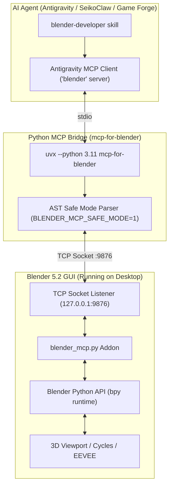

# Blender Developer & 3D Procedural MCP Orchestrator

The **Blender Developer** skill provides autonomous, bi-directional control over a live running Blender 3D instance via the Model Context Protocol (MCP). It enables agents to procedurally generate 3D assets, dress scenes, configure PBR materials, search and import online assets (Poly Haven, Poly Pizza, Sketchfab, BlendSwap), and visually inspect rendered results using multi-angle feedback loops.

---

## 1. System Architecture & Connection Protocol



### Connection Requirements:
1. **Blender GUI Active**: Blender must be running with a GUI (commands do not execute in headless `blender -b` without `xvfb`).
2. **Addon Enabled**: `Interface: MCP for Blender` must be active under `Edit -> Preferences -> Add-ons`.
3. **TCP Listener**: Press `N` in the 3D viewport, open the **MCP for Blender** tab, and ensure **Start MCP Server** is running on `127.0.0.1:9876`.
4. **Agent MCP Server**: The `blender` server is registered globally in `~/.gemini/config/mcp_config.json`.

---


## 2. Technical Art Skill Dispatcher & Decision Router (`bld-*` Suite)

`blender-developer` operates as the Senior Technical Director for all 3D operations in SeikoClaw. Rather than improvising general-purpose BPY scripts from scratch, **always analyze the task signals first and dispatch to the matching specialized skill from the 94-skill `bld-*` library** (imported from `arjun988/blender-skills`). 

### A. The 5-Axis Triage Framework
Before writing or executing any BPY code, evaluate the user request against these 5 axes:

| Axis | Guiding Question | Primary `bld-*` Routing Targets |
| :--- | :--- | :--- |
| **1. Discipline** | What kind of entity is being created? | `bld-hard-surface`, `bld-prop-artist`, `bld-vehicle-artist`, `bld-environment-artist`, `bld-vegetation-artist`, `bld-character-artist`, `bld-creature-artist`, `bld-character-archetypes`, `bld-archviz` |
| **2. Production Stage** | Where in the DCC pipeline does this live? | `bld-sculpting` -> `bld-retopology` -> `bld-uv-workflow` -> `bld-materials` -> `bld-texture-workflow` -> `bld-hair-groom` / `bld-cloth-sim` -> `bld-rigging` -> `bld-animation` -> `bld-lookdev` |
| **3. Technical System** | Does the asset require proceduralism, simulation, or visual FX? | `bld-geometry-nodes`, `bld-procedural-modeling`, `bld-vfx-fx`, `bld-physics-sim`, `bld-lighting`, `bld-camera-cinematography`, `bld-compositing`, `bld-rendering` |
| **4. Art Style & Mood** | What visual aesthetic, console era, or mood must be maintained? | **Core/Extended**: `bld-lowpoly-style`, `bld-stylized-style`, `bld-realistic-style`, `bld-anime-style`, `bld-retro-16bit-style`, `bld-pixel-art-style`, `bld-hd-2d-style`, `bld-voxel-style`, `bld-frutiger-aero-style`<br>**Horror Packs**: `bld-horror-style`, `bld-psx-horror-style`, `bld-cosmic-eldritch-horror`, `bld-analog-found-footage-horror`, `bld-liminal-space-style`, `bld-body-horror-style`<br>**Worlds & Moods**: `bld-sci-fi-punk-worlds`, `bld-fantasy-worlds`, `bld-apocalypse-worlds`, `bld-dark-gritty-mood`, `bld-cozy-wholesome-mood`, `bld-brutalist-mood` |
| **5. Engine Pipeline** | What destination runtime is the asset optimized for? | `bld-asset-optimization`, `bld-lod-pipeline`, `bld-collision-proxy`, `bld-export-pipeline`, `bld-godot-export`, `bld-unity-export`, `bld-unreal-export` |

### B. Core Skill Dispatch Matrix

| Task Signal / Goal | Recommended `bld-*` Skill | Supporting References & Standards |
| :--- | :--- | :--- |
| **Weapons, mechs, sci-fi guns, machinery** | `bld-hard-surface` | `references/polycount-budgets.md`, `references/naming-conventions.md` |
| **Dungeon props, furniture, crates, loot** | `bld-prop-artist` | `bld-asset-optimization`, `references/polycount-budgets.md` |
| **Modular dungeon tiles, buildings, terrain** | `bld-environment-artist` | `bld-scene-assembly`, `bld-set-dressing`, `bld-geometry-nodes` |
| **Trees, foliage, grass, nature assets** | `bld-vegetation-artist` | `bld-lod-pipeline`, `references/polycount-budgets.md` |
| **Humanoid base meshes, game characters** | `bld-character-artist` | `bld-character-archetypes`, `bld-retopology`, `bld-rigging` |
| **Monsters, aliens, organic creatures** | `bld-creature-artist` | `bld-sculpting`, `bld-retopology`, `bld-materials` |
| **Hair, fur cards, particle grooming** | `bld-hair-groom` | `bld-character-artist`, `bld-materials` |
| **Capes, banners, cloth simulation & bakes** | `bld-cloth-sim` | `bld-physics-sim`, `references/asset-pipeline.md` |
| **Bones, IK/FK constraints, weight painting** | `bld-rigging` | `bld-animation`, `references/naming-conventions.md` |
| **Locomotion, walk cycles, attack anims** | `bld-animation` | `.agents/skills/bld-animation/references/walk-cycle.md` |
| **Procedural scatter, rocks, cable paths** | `bld-geometry-nodes` | `bld-procedural-modeling` |
| **PBR node trees, procedural shaders, glass** | `bld-materials` | `bld-lookdev`, `bld-texture-workflow` |
| **PS1 / retro / crunch aesthetic** | `bld-psx-horror-style` | `bld-visual-console-eras`, `bld-lowpoly-style` |
| **Liminal spaces, Backrooms, fluorescent halls** | `bld-liminal-space-style` | `bld-lighting`, `bld-horror-style` |
| **Godot 4.7 collision & glTF export** | `bld-godot-export` | `bld-collision-proxy`, `bld-asset-optimization` |
| **Unity 6.3 LTS humanoid & prefab export** | `bld-unity-export` | `bld-lod-pipeline`, `bld-collision-proxy` |
| **Unreal Engine 5.8 Nanite & UCX collision** | `bld-unreal-export` | `bld-collision-proxy`, `bld-lod-pipeline` |
| **Reference Image / Concept Art Matching** | `bld-blender-director` | `references/reference-image-match.md`, `references/reference-analysis-template.md` |

### C. Multi-Skill Execution Pipeline
When orchestrating a full asset lifecycle:
1. **Route & Plan**: Consult `bld-blender-director` or the matrix above to establish polycount limits from `references/polycount-budgets.md`.
2. **Execute via MCP**: Run procedural BPY scripts in Blender using the idiomatic patterns in Section 4 (`execute_blender_code`).
3. **Inspect Visually**: Capture multi-angle renders using `look(mode="angles")` and compare against reference images.
4. **Deterministic Validation (BVVP)**: Run `validate_blender_asset.py` (Section 6) to verify 0 unapplied transforms, 0 non-manifold edges, and watertight geometry.
5. **Certify Visual Bar**: Attain 0 visual punches against `art/BAR.md` before final engine export.

---

## 3. Core Tool Reference

All Blender tools are invoked via `call_mcp_tool` with `ServerName: "blender"`:

### A. Connection & Introspection
- `get_addon_status()`: Verify Blender version, protocol handshake, and active asset providers. Call this first.
- `get_scene_info(fields, query, root, limit)`: Compact structured metadata (transforms, bounding boxes, polygon counts, topology health). Avoids context explosion.
- `disable_telemetry()`: Opt out of usage data collection.

### B. Visual Self-Verification ("The Eyes")
- `look(mode, shading, max_size, target)`:
  - `mode="angles"`: Auto-framed 4-view contact sheet (Front, Side, Top, Iso) for silhouette and proportion checks.
  - `mode="camera"`: Render from the active scene camera.
  - `mode="viewport"`: Live viewport capture.
  - `shading="solid" | "material" | "rendered" | "wireframe" | "xray"`: Inspect geometry topology or bones.
  - `max_size=512`: Token-efficient resolution for iterative loops.

### C. Procedural Python Execution
- `execute_blender_code(code)`: Execute Python code directly in Blender's live `bpy` runtime.

### D. Asset Catalog Search & Generation
- `search_assets(source, query, asset_type)`: Search CC0 textures/HDRIs (**Poly Haven**), low-poly models (**Poly Pizza**), or **Sketchfab**.
- `import_asset(source, id, asset_type, target_size)`: Download and auto-place assets into the scene.
- `generate_3d(prompt, image_url, provider)`: Text-to-3D / Image-to-3D generation (Tripo, Hunyuan3D, Hyper3D Rodin).

### E. BlendSwap Asset Acquisition & MCP Pipeline
BlendSwap provides native community `.blend` files with complete rigs, collections, materials, and scenes.
- **MCP Server Tools (`ServerName: "blendswap"` or via remote MCP `https://blendswap.com/api/mcp`)**:
  - `blendswap_search_assets(query, category, license, blender_version, render_engine)`: Search community catalog. Free.
  - `blendswap_get_asset(asset_id)`: Inspect license, creator profile, file versions, and byte size. Free.
  - `blendswap_get_balance()`: Free check of daily free allowance (7/day on free accounts) and credit balance.
  - `blendswap_download_asset(asset_id, file_id, dest_dir)`: Downloads `.blend` (extracts from `.zip` if packed) and generates scene append script.
  - `blendswap_generate_append_code(blend_filepath, ground_to_z)`: Generates ready-to-run BPY code for `execute_blender_code`.
- **CLI Helper (`scripts/blendswap_client.py`)**:
  - `python .agents/skills/blender-developer/scripts/blendswap_client.py balance`
  - `python .agents/skills/blender-developer/scripts/blendswap_client.py search --query "chest" --license cc0`
  - `python .agents/skills/blender-developer/scripts/blendswap_client.py download --id 12345 --output-dir assets/blendswap`
  - `python .agents/skills/blender-developer/scripts/blendswap_client.py append-code --file ./assets/blendswap/chest.blend`
- **Environment**: Set `BLENDSWAP_API_KEY` (generate at `https://blendswap.com/dashboard/api`).


---

## 4. Idiomatic BPY Scripting Rules

When writing Python code for `execute_blender_code`, follow these non-negotiable rules:

### 1. Robust Shader Node Lookup (Never Use Localized Names)
Node names like `"Principled BSDF"` vary across languages. Always look up nodes by `node.type`:
```python
import bpy

mat = bpy.data.materials.new(name="M_Armor")
mat.use_nodes = True
nodes = mat.node_tree.nodes
principled = next(n for n in nodes if n.type == "BSDF_PRINCIPLED")

# Set Base Color (RGBA)
principled.inputs["Base Color"].default_value = (0.2, 0.5, 0.8, 1.0)
# Set Roughness & Metallic
principled.inputs["Roughness"].default_value = 0.3
principled.inputs["Metallic"].default_value = 0.9
```

### 2. Mesh Cleanup & Bounding Box Grounding
Never leave imported or generated models floating:
```python
import bpy

obj = bpy.context.active_object
if obj and obj.type == 'MESH':
    # Calculate world bounding box z-min
    bbox_corners = [obj.matrix_world @ mathutils.Vector(corner) for corner in obj.bound_box]
    min_z = min(corner.z for corner in bbox_corners)
    # Snap bottom face to Z = 0 ground plane
    obj.location.z -= min_z
```

### 3. Safe Dynamic Enums
Never hardcode enum identifiers without runtime verification:
```python
import bpy

# Read available render engines dynamically
valid_engines = [item.identifier for item in bpy.types.RenderSettings.bl_rna.properties["engine"].enum_items]
if "CYCLES" in valid_engines:
    bpy.context.scene.render.engine = "CYCLES"
```

---

## 5. Game Asset Export Pipelines

### A. Web / Godot / Unreal glTF Export
```python
import bpy

bpy.ops.export_scene.gltf(
    filepath="d:/DevWorkspace/GameProject/assets/models/character.glb",
    export_format='GLB',
    use_selection=True,
    export_apply=True,
    export_materials='EXPORT',
    export_yup=True
)
```

### B. 8-Directional Isometric Sprite Sheet Rendering
For 2D pixel-art / isometric games, Blender acts as an automated sprite rendering engine:
```python
import bpy
import math

camera = bpy.data.objects['Camera']
angles = [0, 45, 90, 135, 180, 225, 270, 315]

for i, angle in enumerate(angles):
    camera.rotation_euler[2] = math.radians(angle)
    bpy.context.scene.render.filepath = f"d:/DevWorkspace/GameProject/assets/sprites/char_dir_{i}.png"
    bpy.ops.render.render(write_still=True)
```

---

## 6. Mandatory Verification & Validation Protocol (BVVP)

Every action modifying or creating a visual asset in Blender MUST pass the **Blender Verification & Validation Protocol (BVVP)** before being exported to game engines (Godot/Unity/Unreal) or entered into `assets.base`.

```mermaid
flowchart TD
    Action["Blender Asset Creation / Import"] --> S1
    S1["Step 1: Deterministic DCC Validation<br/>(scripts/validate_blender_asset.py)"] --> C1{0 Geometric<br/>Errors?}
    C1 -->|No| Fix1["Apply Immediate BPY Fixes<br/>(Apply scale, ground Z=0, fix normals)"] --> S1
    C1 -->|Yes| S2["Step 2: Web Reference Grounding<br/>(scripts/fetch_asset_references.py)"]
    S2 --> S3["Step 3: Multi-Angle Capture & SxS Composite<br/>look(mode='angles') + Reference Image"]
    S3 --> C2{Passes Visual<br/>Bar (art/BAR.md)?}
    C2 -->|No| Punch["Emit Actionable BPY Defect Punch List"] --> BPYRemediate["Execute Remediation in BPY"] --> S1
    C2 -->|Yes| Certify["Certify [GATE: BLENDER_VALIDATION]"]
```

### Step 1: Deterministic DCC Validation (Layer 1)
Execute the in-scene validation suite via `execute_blender_code` to catch mathematical and topological defects before doing any visual inspection:

```python
import sys
sys.path.append("d:/DevWorkspace/SeikoClaw-Harness/scripts")
import validate_blender_asset

# Run in-scene assertion on active scene meshes
report = validate_blender_asset.validate_active_scene(
    max_tris=15000,
    allow_unapplied_scale=False,
    ground_tolerance=0.005,
    check_manifold=True,
    no_ngons=False
)
print(validate_blender_asset.json.dumps(report, indent=2))
assert report["passed"], f"DCC Validation Failed: {report}"
```
**Invariants Checked**:
- **Scale Applied**: `(1.0, 1.0, 1.0)` on all meshes (unapplied scale distorts physics, UVs, and modifiers).
- **Ground Alignment**: Lowest mesh vertex snapped to ground plane ($Z = 0 \pm 0.005$).
- **Watertightness**: 0 non-manifold edges, 0 loose vertices/edges, 0 zero-area faces.
- **Shaders & Textures**: Every slot has an active `BSDF_PRINCIPLED` node; zero missing/pink textures (`image.filepath` verified on disk).

### Step 2: Plain English Description Intake & Web Reference Acquisition
Save the plain English description used to author the asset and query ground-truth visual references from public image catalogs (e.g., Wikimedia Commons / museum collections):

```bash
python scripts/fetch_asset_references.py search \
    --description "medieval iron-banded wooden treasure chest with curved barrel lid" \
    --asset-name "iron_chest" \
    --limit 2
```
References are downloaded to `captures/refs/<asset_name>/ref_01.jpg` along with metadata in `prompt.json`.

### Step 3: Multi-Angle Capture, SxS Compositing & Actionable Critique
1. Call `look(mode="angles", shading="rendered")` via Blender MCP to produce an auto-framed 4-view contact sheet (`Front`, `Side`, `Top`, `Iso`).
2. Generate a Side-by-Side (SxS) comparison composite:
   ```bash
   python scripts/fetch_asset_references.py composite \
       --ref "captures/refs/iron_chest/ref_01.jpg" \
       --capture "captures/renders/iron_chest_angles.png" \
       --output "captures/sxs/iron_chest_sxs.png"
   ```
3. Evaluate against [art/BAR.md](../../art/BAR.md) and reference images across the 5 Visual Pillars:
   - *Silhouette & Proportions*: Head-to-handle ratios, lid curves, bevel widths.
   - *Material Values & Metallicity*: Roughness, specular highlights, color temperature.
   - *Readability & Key Features*: Described details (latches, runes, straps) clearly visible.
4. **Actionable Remediation**: If defects are observed, output a numbered punch list with exact BPY code fixes:
   ```markdown
   ### Punch Item #1: Lid Bevel Rounding
   - **Observed Defect**: Chest lid is a sharp angular box; reference has a soft curved barrel lid.
   - **Actionable BPY Fix**:
     ```python
     mod = obj.modifiers.new(name="Bevel", type='BEVEL')
     mod.width = 0.04
     mod.segments = 4
     ```
   ```

### Step 4: Standalone Export Validation (When Emitting .glb)
When exporting assets to game engine directories, verify the binary container using the CLI validator:
```bash
python scripts/validate_blender_asset.py "assets/models/character.glb" --max-tris 15000
```
Must return `{"status": "PASS"}` before task completion.

---

## 7. External `.blend` Asset Ingestion Pipeline (BlendSwap)

When downloading community assets from BlendSwap, they arrive as native `.blend` files or zipped archives. Follow this autonomous execution pipeline:

1. **Quota & Balance Check**:
   Before downloading, check account limits via `blendswap_get_balance()` or `python blendswap_client.py balance`. Free accounts have 7 downloads/day; subsequent downloads cost 10 credits.
2. **Search & Evaluate**:
   Use `blendswap_search_assets(query=...)` to identify candidates. Inspect uploader licenses (`CC0`, `CC-BY`, `CC-BY-SA`).
3. **Download**:
   Execute `blendswap_download_asset(asset_id=...)` or `python blendswap_client.py download --id <ID>`. The client downloads the `.blend` file into `assets/blendswap/`.
4. **Append & Ground**:
   Execute the generated append script via `execute_blender_code`:
   ```python
   # Load collections or objects from .blend, link to active scene, snap lowest mesh vertex to Z=0 ground
   import bpy, mathutils
   from pathlib import Path
   # See references/bpy_recipes.md Section 5 for full implementation
   ```
5. **Inspect & Polish**:
   Run `look(mode="angles")` to verify visual placement, scale, and materials.

