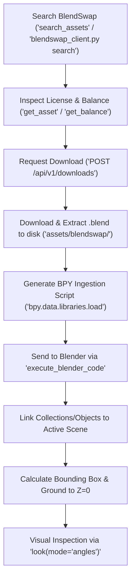

# BlendSwap 3D MCP & REST API Evaluation Guide

Evaluation and architectural reference for integrating **BlendSwap** assets into Blender via the REST API (v1), the official remote Model Context Protocol (MCP) server, and the local SeikoClaw Blender MCP pipeline.

---

## 1. Executive Summary & Architectural Evaluation

BlendSwap (`https://blendswap.com`) is the primary open community catalog for Blender-native 3D assets (`.blend` files), materials, procedural node groups, character rigs, and animation setups.

### Comparison: BlendSwap vs. Existing Blender Asset Sources

| Capability | Poly Haven | Poly Pizza | Sketchfab | BlendSwap |
| :--- | :--- | :--- | :--- | :--- |
| **Asset Formats** | HDRIs, PBR Textures, GLTF | Low-poly GLTF / OBJ | GLTF / USDZ | **Native `.blend` files**, materials, rigs |
| **Blender Versioning** | Neutral | Neutral | Neutral | **Tagged per Blender version** (e.g. 4.2, 5.2) |
| **Render Engines** | Cycles / Eevee | Eevee / Workbench | Neutral | **Cycles, EEVEE, Workbench, Octane, Lux** |
| **Data Hierarchy** | Single mesh or material | Single mesh | Meshes + basic rigs | **Collections, Object trees, Armatures, NodeGroups** |
| **Ingestion Operator** | Material builder / HDRI setup | `import_scene.gltf` | `import_scene.gltf` | **`bpy.data.libraries.load` (Append / Link)** |
| **Licensing** | CC0 | CC0 / CC-BY | Varied (CC-BY, NC) | **CC0, CC-BY, CC-BY-SA, GAL, Commercial** |
| **Access Model** | Free, unauthenticated | Free, unauthenticated | API token required | **Daily free allowance (7/day), then credits** |

---

## 2. API Endpoints & Transport Protocols

### Base Endpoints
- **REST API v1:** `https://blendswap.com/api/v1`
- **Remote MCP Server:** `https://blendswap.com/api/mcp` (Streamable HTTP / SSE, JSON-RPC 2.0)

### Authentication
All requests require an API key generated from the BlendSwap dashboard (`https://blendswap.com/dashboard/api`).
- Keys are prefixed with `bsk_live_`.
- Header: `Authorization: Bearer bsk_live_...`
- Query String Fallback: `?key=bsk_live_...` (for clients unable to inject custom headers).
- Browser session cookies are strictly rejected.

---

## 3. REST API Specification (`/api/v1`)

### 1. Catalog Search: `GET /api/v1/assets`
- **Cost:** Free ($0).
- **Parameters:**
  - `q`: Full-text search over title, description, and tags (supports syntax `"low poly" -car`).
  - `license`: Comma-separated keys: `cc0`, `cc_by`, `cc_by_sa`, `cc_by_nc`, `gal`, `commercial`.
  - `type`: Comma-separated asset types: `model_3d`, `material`, `tool`, `hdri`, `simulation`, `theme`, `addon`.
  - `format`: Required file format: `blender`, `texture`, `fbx`, `gltf`, `obj`, `stl`, `usd`.
  - `category`: Category slug from `/api/v1/categories` (for `model_3d`).
  - `tag`: Single exact tag match.
  - `blender_version`: Target Blender version string (e.g. `"4.2"`, `"5.2"`).
  - `render_engine`: `cycles`, `eevee`, `workbench`, `octane`, `luxrender`, etc.
  - `sort`: `newest`, `downloads`, `likes` (default `newest`).
  - `page`: 1-based page index.
  - `per_page`: 25 default, 100 maximum.
- **Envelope:**
  ```json
  {
    "data": [
      {
        "id": 12345,
        "title": "Stylized Treasure Chest",
        "asset_type": "model_3d",
        "license": { "key": "cc0", "name": "CC0", "url": "https://creativecommons.org/publicdomain/zero/1.0/" },
        "license_source": "uploader_declared",
        "category": { "id": 7, "name": "Props", "slug": "props" },
        "author": { "id": 42, "username": "3d_artist", "url": "https://blendswap.com/profile/42" },
        "blender_versions": ["4.2"],
        "size_bytes": 1048576,
        "files": [
          { "id": 9001, "format": "blender", "software_version": "4.2", "render_engine": "cycles" }
        ]
      }
    ],
    "pagination": { "page": 1, "pages": 12, "count": 284, "per_page": 25 }
  }
  ```

### 2. Single Asset Details: `GET /api/v1/assets/:id`
- **Cost:** Free ($0).
- Returns full asset metadata, uploader profile, descriptions, counts, and available live files.

### 3. File Listing: `GET /api/v1/assets/:id/files`
- **Cost:** Free ($0).
- Returns list of downloadable files with software version, render engine, file size in bytes, and `file_id`.

### 4. Download Request: `POST /api/v1/downloads`
- **Cost:** Free within daily allowance (7/day on free accounts, 50 on Friend, 100 on Artist/Studio); then 10 credits per download.
- Re-downloading the same file within 24 hours is free (`reason: "repeat"`).
- **Request Body:**
  ```json
  {
    "asset_id": 12345,
    "file_id": 9001
  }
  ```
  *(Note: `file_id` is optional and defaults to the first live file.)*
- **Response Payload:**
  ```json
  {
    "download_url": "https://...signed_temporary_url...",
    "expires_at": "2026-10-17T16:00:00Z",
    "charged": false,
    "credits_spent": 0,
    "credits_remaining": 150,
    "reason": "free_allowance",
    "preview_urls": ["https://blendswap.com/blend_previews/12345/0/500?v=..."],
    "license": { "key": "cc0", "name": "CC0" },
    "license_source": "uploader_declared"
  }
  ```

### 5. Account Balances: `GET /api/v1/me`
- **Cost:** Free ($0).
- Returns active key information, remaining free daily downloads, and credit balances.

---

## 4. Model Context Protocol (MCP) Integration

BlendSwap exposes a stateless remote MCP server at `https://blendswap.com/api/mcp` over Streamable HTTP (JSON-RPC 2.0).

### Core MCP Tools
1. `search_assets`: Searches catalog and filters by query, category, license, format, and render engine.
2. `get_asset`: Returns asset metadata, author details, and file IDs.
3. `download_asset`: Generates 1-hour presigned URL, preview image links, and license information.
4. `get_balance`: Checks remaining credits and daily download allowances.

### Connecting AI Clients

#### Option A: Direct Remote MCP (`mcp_config.json` / Claude Desktop)
```json
{
  "mcpServers": {
    "blendswap": {
      "url": "https://blendswap.com/api/mcp",
      "headers": {
        "Authorization": "Bearer bsk_live_YOUR_KEY"
      }
    }
  }
}
```

#### Option B: SeikoClaw Local MCP Bridge Server (`blendswap_mcp_server.py`)
For stdio-based agents or workflows requiring automatic `.blend` extraction and BPY code generation:
```json
{
  "mcpServers": {
    "blendswap": {
      "command": "python",
      "args": [
        "d:\\DevWorkspace\\SeikoClaw-Harness\\.agents\\skills\\blender-developer\\scripts\\blendswap_mcp_server.py"
      ],
      "env": {
        "BLENDSWAP_API_KEY": "bsk_live_YOUR_KEY"
      }
    }
  }
}
```

---

## 5. Automated Blender Ingestion Pipeline

Because BlendSwap delivers `.blend` files (or `.zip` archives containing `.blend` files), they cannot be loaded with standard mesh importers (`import_scene.gltf` or `import_scene.obj`). They must be **appended** or **linked** into the active Blender scene using `bpy.data.libraries.load`.

### The Ingestion Sequence:


### Ingestion Python Logic (`bpy`):
```python
import bpy
import mathutils
from pathlib import Path

blend_path = "d:/DevWorkspace/SeikoClaw-Harness/assets/blendswap/chest.blend"

# 1. Inspect data-blocks inside external .blend
with bpy.data.libraries.load(blend_path, link=False) as (data_from, data_to):
    if data_from.collections:
        data_to.collections = list(data_from.collections)
    elif data_from.objects:
        data_to.objects = list(data_from.objects)

# 2. Link into active collection
appended_objects = []
if hasattr(data_to, 'collections') and data_to.collections:
    for coll in data_to.collections:
        bpy.context.scene.collection.children.link(coll)
        appended_objects.extend(coll.all_objects)
elif hasattr(data_to, 'objects') and data_to.objects:
    for obj in data_to.objects:
        bpy.context.scene.collection.objects.link(obj)
        appended_objects.append(obj)

# 3. Grounding mesh objects to Z=0
if appended_objects:
    mesh_objs = [o for o in appended_objects if o and o.type == 'MESH']
    if mesh_objs:
        all_min_z = [min((o.matrix_world @ mathutils.Vector(c)).z for c in o.bound_box) for o in mesh_objs]
        global_min_z = min(all_min_z)
        for root in [o for o in appended_objects if o.parent is None]:
            root.location.z -= global_min_z
```

---

## 6. Safety, Rate Limits & Credit Rules

1. **Daily Quotas**: Free accounts have 7 downloads/day. Paid accounts (Friend/Artist/Studio) have 50–100 downloads/day.
2. **Paid Metering**: After free allowance, downloads cost 10 credits. Always inspect `credits_remaining` or check with the operator before spending.
3. **Repeats**: Re-downloading the same file within 24 hours costs 0 credits.
4. **Rate Limits**: 60 requests/minute per key, 20 download calls/minute, 1,000 total requests/day (tracked by `X-RateLimit-*` headers).
5. **License Verification**: Licenses are declared by uploaders (`uploader_declared`). Always verify license attribution requirements (`CC-BY`, `CC-BY-SA`) before shipping in commercial game projects.
