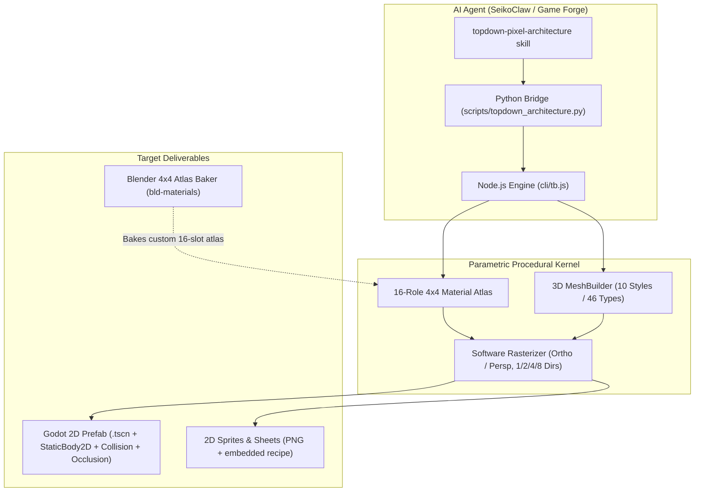

# Topdown Pixel Architecture: Parametric 3D-to-2D Asset Foundry

The **`topdown-pixel-architecture`** skill connects SeikoClaw to the **Parametric Topdown Pixel Architecture Studio** ([`Zengkailin/parametric-topdown-pixel-architecture`](https://github.com/Zengkailin/parametric-topdown-pixel-architecture)). Originating as a pure web port of the Godot addon `addons/hd2d_scene_tools`, it procedurally constructs parametric 3D architectural geometry and rasterizes it into crisp 2D top-down and HD-2D pixel art spritesheets in **~0.3 seconds on CPU with zero GPU dependencies**.

---

## 1. System Architecture & Pipeline Role



### Core Invariants:
1. **Zero External Dependencies**: Operates entirely with Node.js 18+ standard library and pure vanilla JavaScript. No `npm install` or GPU required.
2. **Byte-for-Byte Determinism**: Seed sequences (`--seed`, `--dseed`, `--aseed`) guarantee pixel-perfect repeatability.
3. **Embedded PNG Metadata**: Every exported PNG embeds the generator version and complete recipe JSON in `iTXt` / `tEXt` chunks. Inspecting an image (`inspect`) or feeding it back (`rec apply <png>`) perfectly reconstructs the building.
4. **Native Godot 2D Engine Integration**: Directly produces ready-to-instantiate `.tscn` prefabs with ground collision polygons aligned to camera projection and upper-story occlusion areas.

---

## 2. Quickstart & Command Reference

Execute via either the SeikoClaw Python wrapper or directly through Node:

```bash
# Via SeikoClaw Python sidecar wrapper
python scripts/topdown_architecture.py render forest inn -o assets/buildings/inn.png

# Via direct Node CLI in the vendored sidecar
node sidecars/parametric-topdown-pixel-architecture/cli/tb.js render forest inn -o out/inn.png
```

### Common Commands:

| Task | Command |
| :--- | :--- |
| **Basic Render** | `python scripts/topdown_architecture.py render forest inn -o out/inn.png` |
| **8-Directional Spritesheet** | `python scripts/topdown_architecture.py render jiangnan house -d 8 --sheet -o out/house_8d` |
| **Pixel Art (Hard Outlines, No AA)** | `python scripts/topdown_architecture.py render jiangnan_pixel house --no-aa --outline-silhouette 2 --size 256 -o out/px.png` |
| **Godot Prefab Export** | `python scripts/topdown_architecture.py render forest inn --godot-project D:/DevWorkspace/MyGodotGame --godot-texture res://prefabs/inn.png --godot-prefab res://prefabs/inn.tscn -o out/inn.png` |
| **Inspect PNG Recipe** | `python scripts/topdown_architecture.py inspect out/inn.png` |
| **Replay from Image** | `python scripts/topdown_architecture.py render --recipe out/inn.png -o out/reproduced` |
| **Single-Process Batch Jobs** | `python scripts/topdown_architecture.py batch jobs.json` |
| **Check 4×4 Material Atlas** | `python scripts/topdown_architecture.py atlas-check my_atlas.png` |

---

## 3. Style & Typology Catalog

### A. 10 Built-in Architectural Styles (`--style`)
- `jiangnan`: Southern Chinese water town (whitewashed walls, grey slate roofs, dark wood).
- `jiangnan_pixel`: Tuned palette with high-contrast pixel boundaries for retro aesthetics.
- `forest`: Rustic timber, mossy stone bases, thatch/wood shingle roofs.
- `desert`: Sandstone, adobe plaster, flat and domed roofs, earth tones.
- `machiya`: Traditional Japanese wooden townhouses with lattice screens and tiled gables.
- `nordic`: Heavy log timber, steep pitched A-frame roofs, stone fireplaces.
- `harbor`: Weathered nautical wood, rusted metal trims, dockside stilts.
- `palace`: Imperial Chinese courtyards, sweeping curved glazed eave tiles, vibrant red lacquer.
- `gothic`: Pointed arches, vertical masonry, buttresses, iron crestings.
- `steamworks`: Industrial brick, copper boilers, exposed pipes, riveted metal plates.

### B. 46 Architectural Typologies (`--type`)
- **Residential**: `house`, `farmhouse`, `villa`, `manor`, `abandoned_house`, `ruins`.
- **Commerce & Guilds**: `general_store`, `weaponsmith`, `armorer`, `apothecary`, `market_stall`, `inn`, `tavern`, `teahouse`, `posthouse`, `guild`, `escort_hall`, `clan_hall`.
- **Craft & Industry**: `forge`, `carpenter`, `tailor`, `alchemy`, `granary`, `mill`, `stable`, `animal_shed`, `greenhouse`, `mine`.
- **Civic & Knowledge**: `magistrate`, `town_hall`, `academy`, `library`.
- **Sacred & Mystical**: `temple`, `ancestral_hall`, `cathedral`, `tomb`, `mage_tower`.
- **Fortifications & Transit**: `gate`, `wall`, `watchtower`, `barracks`, `fortress`, `dock`, `boathouse`, `carriage_station`, `checkpoint`.

---

## 4. Parametric Tuning & Part Overrides

### A. Architectural Parameters (`--param <key>=<value>`)
- `width` (3.0 – 10.0): Horizontal building facade span in meters.
- `depth` (0.5 – 10.0): Longitudinal footprint depth in meters.
- `floors` (1 – 3): Number of vertical building stories.
- `pitch` (15 – 50): Roof slope angle in degrees.
- `eave` (0.1 – 1.0): Roof overhang extension beyond walls.
- `windows` (1 – 4): Number of window columns per bay.
- `height` (0.3 – 10.0): Ground elevation and foundation height.
- `bays` (1 – 6): Structural partition columns along the main facade.
- `roof` (`0` = Gable / 硬山, `1` = Hip / 歇山, `2` = Mansard / 攒尖).
- `porch` (`true` / `false`): Front entryway portico or terrace.
- `balcony` (`true` / `false`): Second-story balcony and balustrades.
- `ornament` (`true` / `false`): Decorative ridge finials and brackets.

### B. Part Overrides (`--part <role>:<property>=<value>`)
Target any of the 16 functional material roles (`roof`, `wood`, `wall`, `stone`, `trim`, `glass`, `cloth`, `metal`, `shadow`, `accent`, `door`, `window`, `roof_edge`, `wall_base`, `sign`, `shutter`):
```bash
# Tint roofs gold and add 2px outer outline to walls
python scripts/topdown_architecture.py render jiangnan house \
  --part roof:tint=#e0b95f \
  --part wall:outer=2
```

---

## 5. Godot Engine Prefab Integration

When exporting with `--godot-prefab`, the tool computes 3D ground projection footprints and upper-story occlusion boundaries into native Godot 2D scenes:

```
StaticBody2D (collision_layer=1, collision_mask=0)
├── CollisionPolygon2D   ← Exact foundation quadrilateral projected from 3D ground coordinates
├── Sprite2D             ← Centered on ground origin, referencing trimmed PNG
└── Area2D (Occlusion)   ← Upper-story occlusion polygon (transparent players walk behind roof)
    └── CollisionPolygon2D × N
```

### In-Engine Instantiation via `godot-developer`:
```python
# 1. Export prefab directly to Godot project
from scripts import topdown_architecture

topdown_architecture.render(
    style="forest",
    building_type="inn",
    out="tests/out/inn.png",
    godot_project="D:/DevWorkspace/MyGodotGame",
    godot_texture="res://prefabs/inn.png",
    godot_prefab="res://prefabs/inn.tscn"
)

# 2. Rescan and instantiate node via godot-developer MCP
# call_mcp_tool(ServerName="godot", ToolName="node-create", Arguments={
#     "name": "VillageInn",
#     "parentNodeRef": {"name": "World/YSortBuildings"},
#     "subScenePath": "res://prefabs/inn.tscn"
# })
```

---

## 6. Blender 4×4 Material Atlas Bridge

To introduce bespoke artistic styles using Blender:
1. The tool requires a **4×4 grid PNG (512×512 or 1024×1024)** with 16 strictly mapped cells:
   - Row 1: `roof`, `wood`, `wall`, `stone`
   - Row 2: `trim`, `glass`, `cloth`, `metal`
   - Row 3: `shadow`, `accent`, `door`, `window`
   - Row 4: `roof_edge`, `wall_base`, `sign`, `shutter`
2. Use `scripts/bake_topdown_atlas.py` with `blender-developer` and `bld-materials` to bake procedural procedural shaders into this 16-slot grid.
3. Validate the atlas:
   ```bash
   python scripts/topdown_architecture.py atlas-check custom_atlas.png
   ```
4. Register the new style:
   ```bash
   node sidecars/parametric-topdown-pixel-architecture/cli/tb.js styles create \
     --atlas custom_atlas.png \
     --name "CyberpunkCity" \
     --geometry steamworks \
     --id user_cyberpunk
   ```
