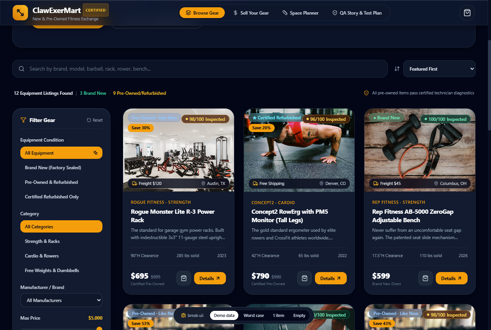
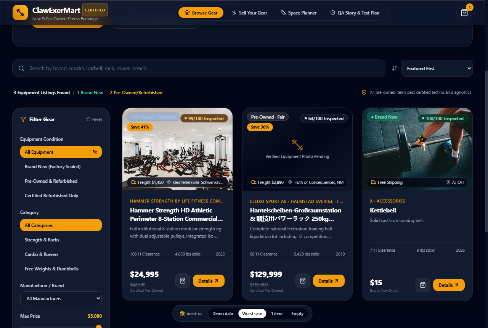
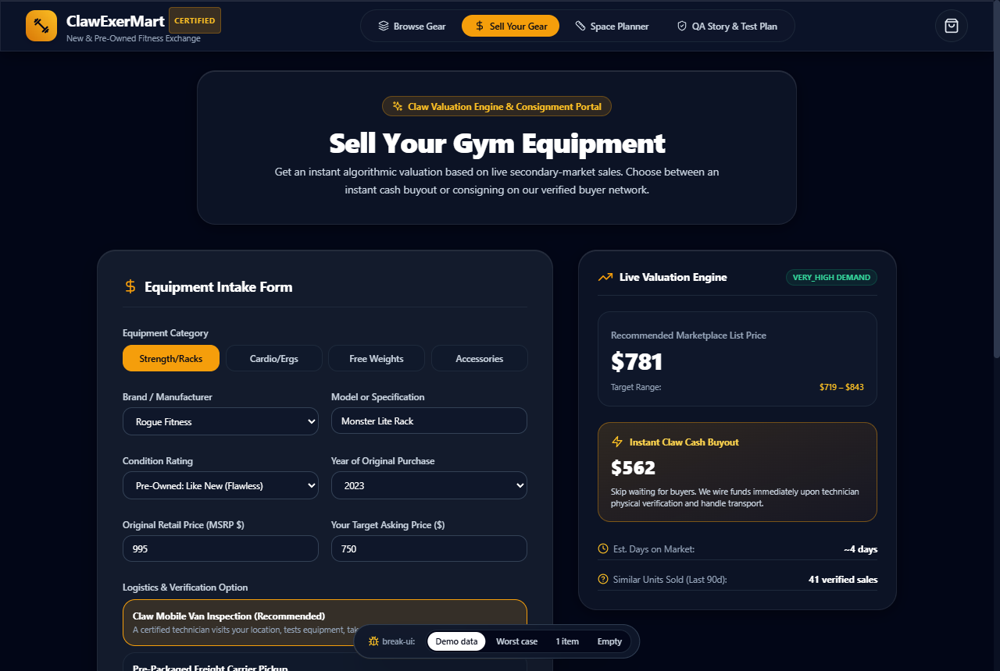
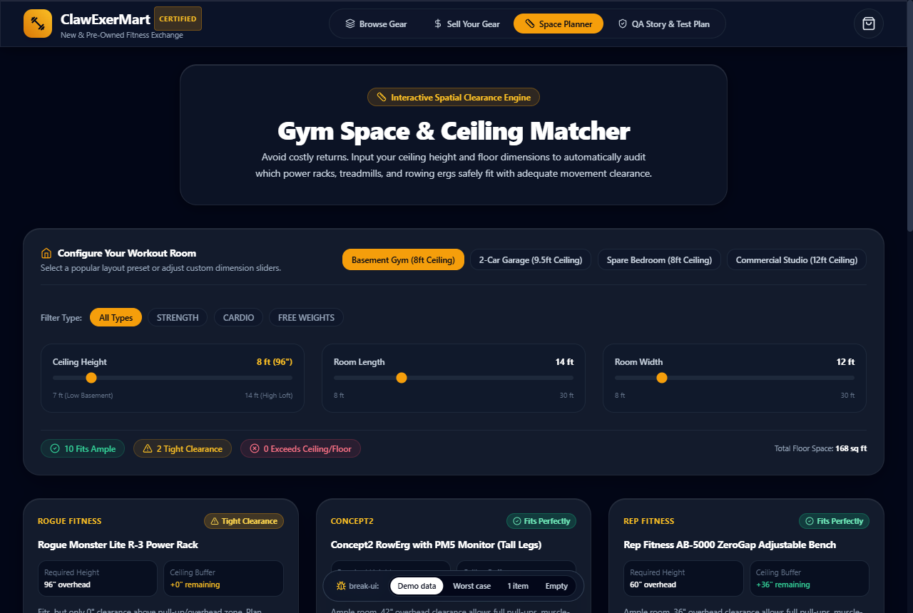
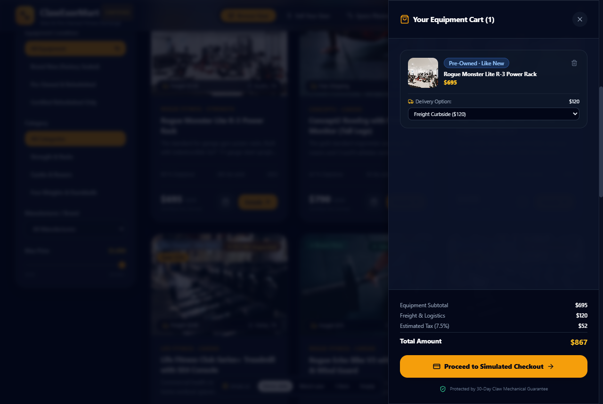

# With vs. without SeikoClaw Harness: the ExerMart case study

- **Interactive GitHub Pages showcase & live split-screen apps**: [`https://saikojin.github.io/seikoclaw-harness/`](https://saikojin.github.io/seikoclaw-harness/)
- **Harness repository**: [`https://github.com/Saikojin/seikoclaw-harness`](https://github.com/Saikojin/seikoclaw-harness)
- **Control group (built without harness)**: [`https://github.com/Saikojin/RawExerMart`](https://github.com/Saikojin/RawExerMart)
- **Treatment group (built with SeikoClaw Harness)**: [`https://github.com/Saikojin/ClawExerMart`](https://github.com/Saikojin/ClawExerMart)

---

## 1. Experiment overview

Both [RawExerMart](https://github.com/Saikojin/RawExerMart) and [ClawExerMart](https://github.com/Saikojin/ClawExerMart) were generated from the same base prompt: build a modern web application for buying, selling, and showcasing new and pre-owned gym equipment modeled after Michael Leonard's [Story Test Plan Template](https://medium.com/@michael.leonard/story-test-plan-template-a4202531e741) with zero PHP dependencies.

Both projects compile cleanly and pass 100% of their automated test suites. The difference lies in **domain modeling depth, physical and spatial constraint calculations, UI and motion physics, adversarial edge-case resilience, and real non-headless browser verification**.

---

## 2. 12-dimension comparison chart

| Dimension | [RawExerMart](https://github.com/Saikojin/RawExerMart) (Without Harness) | [ClawExerMart](https://github.com/Saikojin/ClawExerMart) (With SeikoClaw Harness) | Harness skill or gate responsible |
| :--- | :--- | :--- | :--- |
| **Source footprint** | 27 source files (`2,921` LOC across `client/` and `server/`) | 23 source files (`4,133` LOC in `src/`) | `architect` |
| **Application topology** | Express REST API (`server/src/`) + React SPA (`client/src/`) | React 18 SPA (`src/`) with `CartContext` and URL-persisted dataset modes | `codebase-design` |
| **Core domain features** | 3 workflows: catalog browse/filter, vendor price comparison table, and basic listing modal | 6 workflows: catalog browse/filter, 8-point physical technician inspection sheet, seller counter-offer negotiation, algorithmic consignment/buyout portal, room & ceiling clearance matcher, and LTL freight checkout drawer | `codebase-design` |
| **Pricing & valuation math** | Lowest/average vendor price comparison in `marketplaceComparisonService.ts` | Brand retention multipliers (`1.25x` Eleiko, `1.20x` Concept2, `1.15x` Rogue), condition discount curves, age depreciation floor, and `72%` instant cash buyout offer in `valuation.ts` | `codebase-design` |
| **Spatial & physical modeling** | Static text strings in `specs` dictionary | Interactive 3D room & ceiling clearance calculator (`FITS_PERFECTLY`, `TIGHT_CLEARANCE`, `EXCEEDS_CEILING`, `EXCEEDS_FLOOR`) in `spaceCalculator.ts` | `codebase-design` |
| **Pre-owned trust mechanics** | Single `conditionNotes` string on each item | Structured `InspectionReport` grading frame integrity, bearing runout, cable tension, upholstery rebound, motor hours, and oxidation check | `codebase-design` |
| **Typography & surface styling** | 25-line `index.css` with default Tailwind styles | 78-line `index.css` with `-0.025em` optical heading tracking, `tabular-nums`, and `.apple-glass` (`backdrop-filter: blur(20px) saturate(180%)` + top-edge specular border) | `apple-design`, `seikoclaw-frontend-taste` |
| **Motion & animation physics** | Stock Tailwind `animate-bounce` on toast in `App.tsx`; `500ms` image scale | `.apple-press` pointer scaling (`scale(0.97)` on `cubic-bezier(0.16, 1, 0.3, 1)` at `120ms`), sub-300ms GPU-only transitions, and `@media (prefers-reduced-motion: reduce)` guard | `animate`, `review-animations` |
| **Adversarial UI stress testing** | None; tested only against short, clean demo strings | Live `BreakUiToggle` (`Demo data / Worst case / 1 item / Empty`) with 145-char titles, `$129,999` prices, CJK/diacritics, broken image fallback, and 52-char serial hashes | `break-ui` |
| **Automated test tiers** | 3 tiers in JSDOM/Node: Unit (3 files), Supertest API Integration (2 files), RTL Journey (3 files) = 40 tests | 4 tiers: Unit (2 files), RTL Component + `break-ui` (7 files) = 23 Vitest tests, plus Non-Headless Playwright Chrome E2E (`run-e2e.mjs`) and Visual/Motion Critic gates | `seikojin-qa` |
| **Real browser verification** | 0 browser runs; 0 screenshots | Windowed Chrome execution verifying 0 console errors on the Rabbit Path and capturing 7 PNG proofs in `captures/` | `seikojin-qa` |
| **CI/CD & workflow logs** | `.github/workflows/ci.yml` + `DEV_LOG.md` | `.github/workflows/ci.yml` + `task.md` DAG contracts + `WORKFLOW_LOG.md` | `show-me-your-work`, `code-review` |

---

## 3. Quantitative rubric chart (0 to 10 scale)

```mermaid
xychart-beta
    title "Engineering & Quality Rubric (0-10 Scale): RawExerMart vs. ClawExerMart"
    x-axis ["Domain Depth", "Backend API", "UI & Motion", "Break-UI Resilience", "Browser E2E", "Test Pyramid", "Auditability"]
    y-axis "Score (0 to 10)" 0 --> 10
    bar [5.0, 8.5, 5.0, 4.0, 2.0, 8.0, 7.0]
    bar [9.5, 3.0, 9.5, 9.5, 10.0, 9.5, 9.5]
```

*First bar in each pair: `RawExerMart` (no harness). Second bar: `ClawExerMart` (SeikoClaw Harness).*

---

## 4. Non-headless visual verification captures (`seikojin-qa`)

### `R1_navbar.png`: Hero and frosted glass navigation

### `R2_catalog.png`: Catalog grid with vertically stacked top-left badges

### `R7_break_ui_stress.png`: Adversarial `break-ui` worst-case stress mode (`?data=worst`)

### `R3_product_modal.png`: Certified 8-point physical inspection modal

### `R4_sell_portal.png`: Algorithmic resale and instant cash buyout portal

### `R5_space_matcher.png`: Interactive room and ceiling clearance matcher

### `R6_cart_checkout.png`: LTL freight and liftgate checkout drawer

---

## 5. Adversarial `break-ui` defects uncovered and fixed

| # | Severity | Component & Field | Worst-case input | What broke before fix | Fix applied |
| :--- | :--- | :--- | :--- | :--- | :--- |
| 1 | **Broken** | `Catalog.tsx` (`maxPrice` filter) | `$24,995` & `$129,999` commercial gym lots | Slider max was `5000` (`$5,000+`), silently hiding every item priced over `$5,000` on initial load | Treated `maxPrice === 5000` as unbounded (`$5,000+`) in `Catalog.tsx:73` |
| 2 | **Ugly** | `EquipmentCard.tsx` (`badge-savings`) | Pre-owned item with `Save 30%` pill | Top-left `flex-wrap` row stretched horizontally into the top-right `98/100 Inspected` badge | Stacked top-left badges vertically with `flex-col items-start gap-1.5 max-w-[58%]` in `EquipmentCard.tsx:53` |
| 3 | **Broken** | `EquipmentCard.tsx` & `ProductDetailModal.tsx` (`images[0]`) | Broken URL `https://invalid.example.test/...` | Browser rendered broken image icon with collapsed container contrast | Added `imgError` state and fallback surface (`Verified Equipment Photo Pending`) in `EquipmentCard.tsx:41` |
| 4 | **Ugly** | `EquipmentCard.tsx` (`location.city`) | `Kleinfeltersville-Schwenksville, PA` | Long compound city name wrapped the bottom image overlay onto two lines | Added `min-w-0 truncate` on location and `flex-shrink-0` on freight cost in `EquipmentCard.tsx:76` |
| 5 | **Ugly** | `EquipmentCard.tsx` (`brand`) | `Hammer Strength by Life Fitness Commercial Division` | Brand header wrapped onto 2 lines, misaligning card titles across the 3-column grid | Added `truncate` and `title` tooltip in `EquipmentCard.tsx:88` |
| 6 | **Ugly** | `EquipmentCard.tsx` (`price` + `originalMsrp`) | `$129,999` with `$185,000` strikethrough MSRP | Six-figure price + MSRP compressed the `Add to Cart` and `Details` buttons | Added `tabular-nums`, `min-w-0` on price column, and `flex-shrink-0` on CTA group in `EquipmentCard.tsx:113` |
| 7 | **Ugly** | `Catalog.tsx` (`filteredItems.length`) | `1 item` dataset mode | Rendered `"1 Equipment Listings Found"` | Added singular/plural check (`1 Equipment Listing Found`) in `Catalog.tsx:175` |
| 8 | **Ugly** | `ProductDetailModal.tsx` (`seller.name` & `specs`) | `Aleksandra Wiśniewska-Kowalczyk...` & 52-char serial hash | Long seller name collided with location; unbreakable spec token overflowed right column | Added `min-w-0 truncate` on seller name and `break-all sm:break-words` on spec values in `ProductDetailModal.tsx:128,325` |
