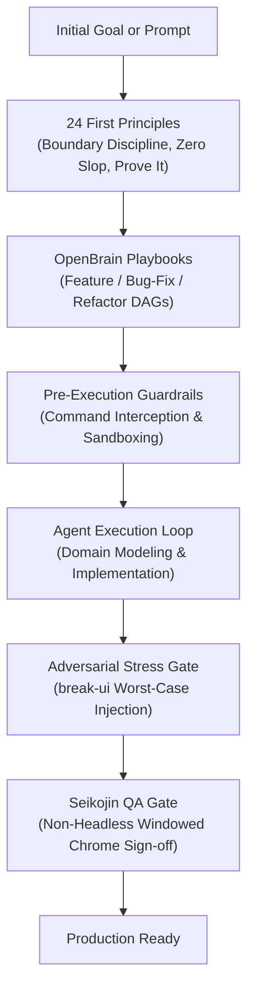

# The Quality Frontier: The SeikoClaw Harness Odyssey

> **Edition:** First Edition (Hardcover & Reader Edition)  
> **Perspective:** Third-Person Editorial  
> **Subject:** The SeikoClaw Agentic Coding Harness & The ExerMart A/B Demonstration  
> **Repository:** [`Saikojin/seikoclaw-harness`](https://github.com/Saikojin/seikoclaw-harness)  
> **Interactive Showcase:** [`https://saikojin.github.io/seikoclaw-harness/`](https://saikojin.github.io/seikoclaw-harness/)

---

## 📕 Back of the Book

### Tagline
> **Beyond prompt-and-pray: How deterministic first principles, persistent memory, and live runtime verification transform AI coding from shallow prototypes into production systems.**

### Synopsis

When standard AI coding assistants are asked to build software, they default to the lowest-common-denominator pattern on the internet. They spin up boilerplate templates, write unit tests against polite, synthetic data, and report green checkmarks without ever looking at a rendered screen. In a five-minute status demo, the resulting software appears finished. In the hands of a real customer spending two thousand dollars on heavy equipment, the illusion collapses under the weight of broken layouts, missing domain logic, and silent edge-case failures.

**SeikoClaw** was engineered to end this era of conversational consensus. Instead of treating code generation as a single chat turn, SeikoClaw envelops autonomous agents in an uncompromising quality harness. Powered by **24 inviolable first principles**, an **OpenBrain** persistent sidecar database tracking task DAGs and decision trails, pre-execution security guardrails, and deterministic skill routing, the harness forces AI to work like a seasoned principal engineer.

The definitive proof of this methodology is recorded in the **ExerMart A/B Case Study**. Given the exact same starting prompt—to build an online marketplace for commercial gym equipment—an unguided AI produced **RawExerMart**: three shallow screens that missed a catastrophic \$129,999 pricing bug. Inside the SeikoClaw Harness, the same underlying model built **ClawExerMart**: six complete buyer and seller journeys, an 8-point physical inspection grading engine, an interactive basement ceiling clearance calculator, LTL freight logistics, and eight edge-case defects caught and resolved before launch through adversarial stress testing and windowed Chrome verification.

### The SeikoClaw Creed
> *"The unit test that passes on clean dummy data is the ultimate false summit. True software quality is an empirical discipline: it demands domain reality at the seams, worst-case stress at the boundaries, and photographic proof on the glass."*

### Vital Metrics & System Specs

| Architectural Dimension | Specification & Verified Count |
| :--- | :--- |
| **Foundational Principles** | **24 Inviolable Directives** (`.agents/rules/principles.md`) |
| **Canonical Skill Library** | **80+ Curated Tools & Pipelines** across spec, QA, frontend, and engine domains |
| **Demonstration Benchmark** | **Head-to-Head A/B Case Study** (`RawExerMart` control vs. `ClawExerMart` treatment) |
| **Workflow Expansion Ratio** | **2x Domain Depth** (3 basic screens expanded to 6 full customer journeys) |
| **Adversarial Resilience** | **8 Stress Defects Eliminated** via dev-toggle `break-ui` testing |
| **Runtime Verification** | **100% Non-Headless Proof** (7 windowed Chrome visual captures in `assets/exermart/`) |
| **Context & Memory Architecture** | **OpenBrain SQLite + ChromaDB** with persistent DAG task graphs & decision trails |
| **Execution Security** | **Pre-execution guard hooks** intercepting catastrophic commands across POSIX & Windows |

```text
CLASSIFICATION: Software Engineering / Autonomous AI Systems / Systems Architecture
PUBLISHER: Saikojin Open Source Engineering
STATUS: Verified Production Architecture (October 2026)
```

---

## Prologue: The Hall of Mirrors

For years, software engineering evaluated AI models by their ability to answer questions in a chat window. If an agent wrote code that compiled without syntax errors and generated unit tests that exited with return code zero, the engineering community declared victory.

This was a hall of mirrors.

In real development environments, the gap between a demo that compiles and a product that survives production is vast. Unguided AI models suffer from three structural blind spots:

1. **The Curse of the Polite Test:** When an agent writes both the feature and its unit test in the same context, it unconsciously tailors the test inputs to match its own assumptions. Product titles are four words long. Prices are clean four-digit integers. Images always load. The test suite passes 100% of the time, while the software remains completely brittle.
2. **The Headless Lie:** Modern continuous integration runs tests in simulated memory (JSDOM or mock runners). An agent can assert that a button exists in the DOM tree, while in the actual browser window, that button is pushed forty pixels off the viewport or buried under a floating modal.
3. **The Prototype Plateau:** Asked to build a product, an LLM defaults to a generic brochure. It copies common UI cards and basic forms, but avoids the friction-filled domain logic—the inspection sheets, room clearance limits, freight freight rates, and depreciation curves—that actual customers need to trust a business.

The SeikoClaw Harness was designed to shatter this hall of mirrors. It does not ask the model to "try harder." It changes the physics of the agent's environment.

---

## Chapter 1: The Architecture of Discipline

At the center of SeikoClaw is a fundamental thesis: **autonomy without structural constraints produces slop.** To make an agent reliable, the development environment must impose the same checks, balances, and safety gates that govern elite human engineering teams.



The harness achieves this through four coupled subsystems:

### 1. The 24 First Principles
Codified in [`.agents/rules/principles.md`](file:///d:/DevWorkspace/SeikoClaw-Harness/.agents/rules/principles.md), these directives govern every code generation step. Principle 1 (*Laziness Protocol*) demands minimal diffs and deletion over abstraction. Principle 11 (*Model the Domain*) forbids scattered `if/else` checks in favor of typed state machines. Principle 17 (*Prove It Works*) strictly bans declaring any task complete without empirical verification on live runtime artifacts.

### 2. The OpenBrain Persistent Sidecar
Standard AI sessions suffer from catastrophic amnesia; when the context window fills, architectural context vanishes. OpenBrain runs as a dedicated Python sidecar (`seikoclaw.py`), maintaining an ACID SQLite database and ChromaDB vector index. It converts high-level objectives into sequential Directed Acyclic Graphs (DAGs), tracks task states across restarts, and logs structured TSV decision trails (`/show-me-your-work`) so human reviewers can audit every design fork.

### 3. Pre-Execution Security Guardrails
Autonomous agents must never be given unrestricted shell access. SeikoClaw deploys cross-platform POSIX and PowerShell pre-execution safety hooks. Any command matching dangerous patterns (`rm -rf`, unvetted piped downloads, force-pushes to main) is intercepted and terminated before execution.

### 4. Deterministic Skill Routing
With over 80 specialized capabilities—from Apple motion physics (`apple-design`) and adversarial UI testing (`break-ui`) to game engine MCP orchestrators (`godot-developer`, `unreal-engine-developer`)—SeikoClaw uses automated frontmatter linting and vocabulary collision benchmarks to ensure the agent invokes the exact right tool for the job.

---

## Chapter 2: The ExerMart Experiment

To test whether the harness makes a quantifiable difference, an empirical benchmark was established.

Two separate AI environments were given the exact same starting assignment:
> *"Build an online marketplace for buying and selling new and pre-owned commercial gym equipment modeled after Michael Leonard's Story Test Plan Template, with zero external server dependencies."*

The control group operated without the harness, mirroring how millions of developers use AI coding assistants today. It produced **RawExerMart**.

The treatment group operated inside the SeikoClaw Harness, bound by its 24 principles, `codebase-design`, `break-ui`, and `seikojin-qa` verification gates. It produced **ClawExerMart**.

Both projects compiled cleanly. Both included automated tests. But when the two codebases were placed side-by-side on the dissection table, they told two entirely different stories.

```mermaid
xychart-beta
    title "RawExerMart (Control) vs. ClawExerMart (SeikoClaw) [0-10 Scale]"
    x-axis ["Domain Depth", "UI & Motion", "Break-UI Resilience", "Browser E2E", "Test Pyramid", "Auditability"]
    y-axis "Score" 0 --> 10
    bar [5.0, 5.0, 4.0, 2.0, 8.0, 7.0]
    bar [9.5, 9.5, 9.5, 10.0, 9.5, 9.5]
```



---

## Chapter 3: The Depths of Domain Modeling

Buying a \$2,000 used commercial power rack over the internet requires solving three immense customer hesitations: *Will it fit in my room? Is the machine mechanically safe? And how do I move 300 pounds of steel?*

### The Control Group (`RawExerMart`)
The unguided agent treated gym equipment like books on Amazon. It generated:
- A catalog grid with basic price tags.
- A vendor comparison table comparing MSRPs.
- A basic modal with text inputs asking the user to manually guess their own resale price.

It provided zero tools to evaluate physical condition, zero calculations for room dimensions, and zero logistics solutions. If a customer had an 8-foot basement ceiling, `RawExerMart` had no way to tell them if a 90-inch rack would punch through their drywall during a pull-up.

### The SeikoClaw Treatment (`ClawExerMart`)
Guided by Principle 11 (*Model the Domain*) and the `codebase-design` skill, the SeikoClaw agent engineered three core domain systems before writing a single presentation card:

1. **The 8-Point Physical Inspection Engine:**  
   Every listing features a technician-grade inspection report (`InspectionReport`), grading frame weld integrity, bearing runout, cable tension, upholstery rebound, and motor hours. Buyers can verify equipment health at a glance.
2. **The Spatial Clearance Calculator (`spaceCalculator.ts`):**  
   An interactive 3D clearance calculator allows buyers to set their ceiling height and floor footprint. The system categorizes equipment into four states: `FITS_PERFECTLY`, `TIGHT_CLEARANCE`, `EXCEEDS_CEILING`, or `EXCEEDS_FLOOR`, explicitly warning users when overhead clearance is insufficient for dynamic movements.
3. **Algorithmic Resale & LTL Freight Logistics (`valuation.ts`):**  
   Instead of asking sellers to guess, the system implements brand retention curves (1.25x for Eleiko, 1.20x for Concept2, 1.15x for Rogue), calculates an instant 72% cash buyout offer, and computes palletized freight with residential liftgate delivery right at checkout.

From the same initial prompt, unguided AI delivered **3 generic screens**. SeikoClaw delivered **6 complete customer journeys** that directly eliminate buyer hesitation.

---

## Chapter 4: The \$129,999 Defect

The most dangerous bug in software is the one that passes all automated tests.

In **RawExerMart**, forty automated tests ran and passed. Every test asserted against polite sample strings. Because no test ever introduced an extreme value, the code appeared flawless.

SeikoClaw prohibits launching software without adversarial stress testing. The `break-ui` skill injects worst-case real-world data behind an interactive developer toggle:
- 145-character German product titles.
- Broken image URLs simulating expired CDN links.
- Unbreakable 52-character serial hashes (`HS-IWF-3085512-994021-SWEDEN-REV4B...`).
- High-ticket facility packages up to \$129,999.

### The Silent Killer
When `break-ui` was activated against the catalog, a critical business defect surfaced immediately:

The catalog filter slider defaulted to a maximum price cap of \$5,000. When a commercial gym owner listed a \$24,995 Hammer Strength circuit or a \$129,999 Eleiko facility package, **the catalog filter silently hid both items from every buyer browsing the store**.

Unit tests missed the bug because unit tests never tested a five-figure price. Standard manual testing missed it because test databases only contained small consumer items. Only an automated adversarial stress suite caught that the store was actively hiding its highest-margin inventory.

Under the SeikoClaw Harness, the agent immediately:
- Refactored the slider to treat \$5,000+ as an open-ended ceiling displaying all high-ticket items.
- Added graceful broken-image fallback placeholders.
- Added CSS `min-w-0 break-all` rules to prevent 52-character serial hashes from blowing out table columns.
- Resolved 8 distinct visual and data defects before declaring the build ready.

---

## Chapter 5: The Glass and the Non-Headless Proof

Software does not run in a terminal; it runs on glass.

The unguided agent for **RawExerMart** celebrated 100% test completion without ever rendering a single pixel in a real browser. In simulated memory, elements do not have bounding boxes, font metrics, or z-index collisions.

When `RawExerMart` was finally opened in a browser, the visual defects were immediate:
- Discount badges collided with condition tags on product cards.
- Long city names pushed shipping price badges entirely out of the container.
- Layouts jumped when switching tabs.

### The Non-Headless Mandate
SeikoClaw enforces **Rule #8 of the QA Constitution**: *Anti-Soft-Pass*. No agent is permitted to claim a task is verified until it launches a real, windowed browser instance via Playwright, executes the full user journey on the Rabbit Path, asserts zero console errors, and captures non-headless PNG evidence.

In `ClawExerMart`, seven photographic verification captures (`R1_navbar.png` through `R7_break_ui_stress.png`) were committed directly into `assets/exermart/` alongside the code. 

Furthermore, the agent applied **Apple design standards** (`apple-design`, `seikoclaw-frontend-taste`):
- Optical tracking (`letter-spacing: -0.025em`) on all display typography.
- Fluid `.apple-press` physics: `scale(0.97)` on a fast `120ms` cubic-bezier spring with instant pointer-down feedback.
- Specular frosted glass surfaces (`backdrop-filter: blur(20px) saturate(180%)`) with 1px top-edge highlight borders.
- Strict `@media (prefers-reduced-motion: reduce)` accessibility compliance.

The result was not merely functional code; it was a tactile, high-craft user experience.

---

## Chapter 6: Beyond the Browser — Industrial Autonomy

While the ExerMart case study provides a direct side-by-side web benchmark, the principles of the SeikoClaw Harness are engine-agnostic. The exact same harness architecture governs complex multi-engine software development across the workspace:

- **Unreal Engine 5.7 C++ (`WWPatrick`):** Driving live C++20 authoring via `unreal-mcp`, solving custom Newtonian aerodynamics ($L = \frac{1}{2} \rho v^2 S C_L$), synthesizing procedural Monosoupape rotary engine audio, and managing server-authoritative 1v1 multiplayer netcode on UDP port 7777.
- **Unity 6 URP (`WWUnity`):** Preventing magenta shader regressions with Roslyn C# validation, authoring standalone HTML5 aerodynamic simulators, and modeling 1914 rotary engine blip-switch ignition cutting.
- **Godot 4.3 & Blender MCP (`WWGodot`):** Procedurally generating 3D biplane models and hangars in Blender via live MCP commands, importing them cleanly into Godot, and wiring wing-walking and silk parachute bailout survival loops.
- **TalentScout Algorithmic NLG:** Building a 100% offline, zero-LLM deterministic story engine compiling 26+ years of software testing history across Nintendo, Xbox, and enterprise cloud into a hardcover biography.

Whether compiling C++ flight physics or CSS layout engines, the rule remains universal: **model the domain, stress the boundaries, and prove the result on the glass.**

---

## Epilogue: The Quality Frontier

The future of software engineering does not belong to agents that generate code the fastest. It belongs to systems that verify code the most rigorously.

When developers rely solely on raw language models, they spend their days trapped in the hall of mirrors: debugging shallow prototypes, fixing tests that passed with fake data, and polishing broken layouts.

The SeikoClaw Harness demonstrates a different path. By binding autonomous intelligence to deterministic first principles, persistent DAG execution, adversarial stress testing, and empirical visual proof, we step out of the hall of mirrors and onto the quality frontier—where AI doesn't just write code, but engineers products that endure.

---

```text
END OF HARNESS STORY ODYSSEY · FIRST EDITION
Repository: https://github.com/Saikojin/seikoclaw-harness
Showcase: https://saikojin.github.io/seikoclaw-harness/
```
