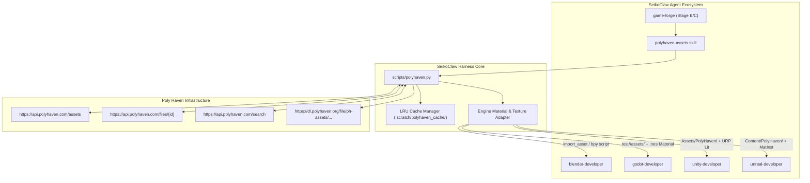

# Poly Haven Asset Integration Plan for SeikoClaw Harness

This specification outlines the technical design, CLI architecture, resolution gating protocol, and multi-engine adapter bridges to integrate the [Poly Haven API](https://api.polyhaven.com/) into the SeikoClaw Harness.

---

## 1. System Architecture



---

## 2. Storage Strategy & 2K Resolution Gating Protocol

Poly Haven provides an extensive library of **2,387 CC0 assets** totaling **8.43 TB (7.67 TiB)** across 178,232 files. Downloading assets without resolution discipline can rapidly consume hundreds of gigabytes.

### Resolution Size Comparison

| Resolution Tier | Texture Set Size (Avg) | HDRI Size (Avg) | Use Case in SeikoClaw | Default Policy |
| :--- | :--- | :--- | :--- | :--- |
| **1k** | 2–5 MB | 1–3 MB | Prototyping, distant background props, mobile | Fast draft |
| **2k** | **10–25 MB** | **5–15 MB** | **Standard game-ready production, realtime rendering** | **DEFAULT** |
| **4k** | 40–90 MB | 20–45 MB | Hero props, player weapons, foreground assets | On-Demand (`--resolution 4k`) |
| **8k** | 150–350 MB | 80–180 MB | Offline architectural rendering, cinematic stills | Explicit override |
| **16k / 24k** | N/A | 300–800 MB | High-end VFX skydomes only | Explicit override |

### Storage Protection Rules
1. **Default Resolution**: Every command without an explicit `--resolution` flag defaults strictly to `2k`.
2. **Selective Map Ingestion**: When fetching textures, the fetcher pulls only required maps (`Diffuse`, `nor_gl`/`nor_dx`, `Rough`, `Metal`/`arm`, and `Displacement` if requested) instead of downloading redundant file formats (e.g., skips downloading `.exr`, `.png`, and `.jpg` simultaneously; defaults to `.png` or compressed `.jpg` based on flag).
3. **Cache Cap & LRU Eviction**: Local cache directory (`.scratch/polyhaven_cache/`) defaults to a **10 GB storage ceiling** with automatic least-recently-used eviction when running `cache --prune`.

---

## 3. CLI Specification (`scripts/polyhaven.py`)

A zero-external-dependency CLI script located in `scripts/polyhaven.py`:

```bash
# 1. Search for assets
python scripts/polyhaven.py search "weathered brick" --type textures --category "brick"

# 2. Inspect asset metadata and file sizes before downloading
python scripts/polyhaven.py info "brick_wall_001"

# 3. Fetch asset (defaults to 2k resolution)
python scripts/polyhaven.py fetch "brick_wall_001" --resolution 2k --target godot --output "D:/DevWorkspace/MyGame/assets/textures/"

# 4. Fetch HDRI for skybox/world lighting
python scripts/polyhaven.py fetch "kloofendal_48d_partly_cloudy" --type hdris --resolution 2k --target blender

# 5. Manage local cache
python scripts/polyhaven.py cache --status
python scripts/polyhaven.py cache --prune --max-size 10GB
```

### CLI Arguments & Options

- `search`:
  - `query` (positional): Text search string.
  - `--type, -t`: Asset type filter (`hdris`, `textures`, `models`, `all`).
  - `--category, -c`: Category slug (e.g. `brick`, `wood`, `nature`).
  - `--json`: Output raw machine-readable JSON for subagents.
- `info`:
  - `slug` (positional): Asset identifier.
  - `--resolution, -r`: Show file sizes for specific resolution tier.
- `fetch`:
  - `slug` (positional): Asset identifier.
  - `--resolution, -r`: Resolution tier (`1k`, `2k`, `4k`, `8k`, `16k`). Default: `2k`.
  - `--target`: Engine target adapter (`raw`, `blender`, `godot`, `unity`, `unreal`). Default: `raw`.
  - `--format`: Format preference (`png`, `jpg`, `exr`, `hdr`, `gltf`, `blend`).
  - `--output, -o`: Destination directory path.
  - `--no-cache`: Bypass local cache and re-download.

---

## 4. Engine Integration Bridges

### A. Blender MCP Bridge (`blender-developer`)
- **Direct MCP Integration**: The existing `blender` MCP server provides `import_asset(source="polyhaven", id=slug, asset_type=type, resolution="2k", apply_to=[...])`.
- **BPY Code Fallback**: If using downloaded files directly:
  ```python
  # Procedural PBR Material setup via execute_blender_code
  import bpy
  mat = bpy.data.materials.new(name=f"M_{slug}")
  mat.use_nodes = True
  nodes = mat.node_tree.nodes
  links = mat.node_tree.links
  bsdf = next(n for n in nodes if n.type == "BSDF_PRINCIPLED")

  # Setup BaseColor, Normal Map, Roughness
  # Links texture nodes to Principled BSDF
  ```

### B. Godot Engine Bridge (`godot-developer`)
- Target directory: `res://assets/polyhaven/{slug}/`
- Texture Normal map convention: Godot expects **OpenGL format (`nor_gl`)**. The bridge automatically selects `nor_gl` from Poly Haven's manifest.
- Material generation: Automatically creates a `.tres` `StandardMaterial3D` alongside the textures:
  ```ini
  [gd_resource type="StandardMaterial3D" load_steps=5 format=3]
  [resource]
  albedo_texture = ExtResource("1_diff")
  normal_enabled = true
  normal_texture = ExtResource("2_nor")
  roughness_texture = ExtResource("3_rough")
  ```

### C. Unity Engine Bridge (`unity-developer`)
- Target directory: `Assets/PolyHaven/{slug}/`
- Normal map convention: Unity expects **DirectX format (`nor_dx`)**. The bridge selects `nor_dx` and writes a companion `.meta` setting `textureType: 1` (Normal Map).
- Linear vs sRGB: Sets `sRGB: 0` in `.meta` for Roughness, Metallic, and ARM maps.
- Material generation: Generates a URP Lit Material referencing the imported GUIDs.

### D. Unreal Engine Bridge (`unreal-developer`)
- Target directory: `Content/PolyHaven/{slug}/`
- Normal map convention: Unreal expects **DirectX format (`nor_dx`)**.
- Ingestion: Writes an import manifest and calls Unreal MCP batch import, then instantiates the project's PBR Master Material with parameterized texture inputs.

---

## 5. Phased Implementation Roadmap & Verification Gates

### Phase 1: Core CLI Utility & Cache Engine
- **Task 1.1**: Create `scripts/polyhaven.py` with `search`, `info`, `fetch`, and `cache` subcommands.
- **Task 1.2**: Implement strict 2K resolution default and map filtering.
- **[GATE: QA]**: Run `python scripts/polyhaven.py fetch "brown_planks_03" --resolution 2k` and verify downloaded set is under 30 MB.

### Phase 2: Skill Definition & Central Router Alignment
- **Task 2.1**: Author `.agents/skills/polyhaven-assets/SKILL.md` detailing API workflows, engine routing, and 2K discipline.
- **Task 2.2**: Update `.agents/skills/seikoclaw-harness/SKILL.md` under Section 1 (Game Development & Visual Parity).
- **[GATE: QA]**: `python scripts/eval_skill_routing.py --check-lint` passes cleanly.

### Phase 3: Engine Adapters Implementation
- **Task 3.1**: Implement Godot `.tres` material and sky generator.
- **Task 3.2**: Implement Unity `.meta` and URP material generator.
- **Task 3.3**: Implement Blender MCP invocation helper and BPY fallback.
- **[GATE: QA]**: Execute dry-run imports for Godot and Blender, validating file tree integrity and correct Normal map orientations.

### Phase 4: Routing Benchmarks & Collision Evaluation
- **Task 4.1**: Add 8+ diverse Poly Haven routing test cases into `evals/routing/routing_cases.json`.
- **Task 4.2**: Verify collision thresholds against `blender-developer` and `asset-generator`.
- **[GATE: QA]**: `python scripts/eval_skill_routing.py --detect-collisions` maintains pairwise similarity < 0.65.

### Phase 5: Test Suite & Knowledge Graph
- **Task 5.1**: Author unit and integration tests in `tests/test_polyhaven.py`.
- **Task 5.2**: Update Graphify knowledge graph (`graphify update .`).
- **[GATE: QA]**: `pytest tests/test_polyhaven.py` passes 100%.
